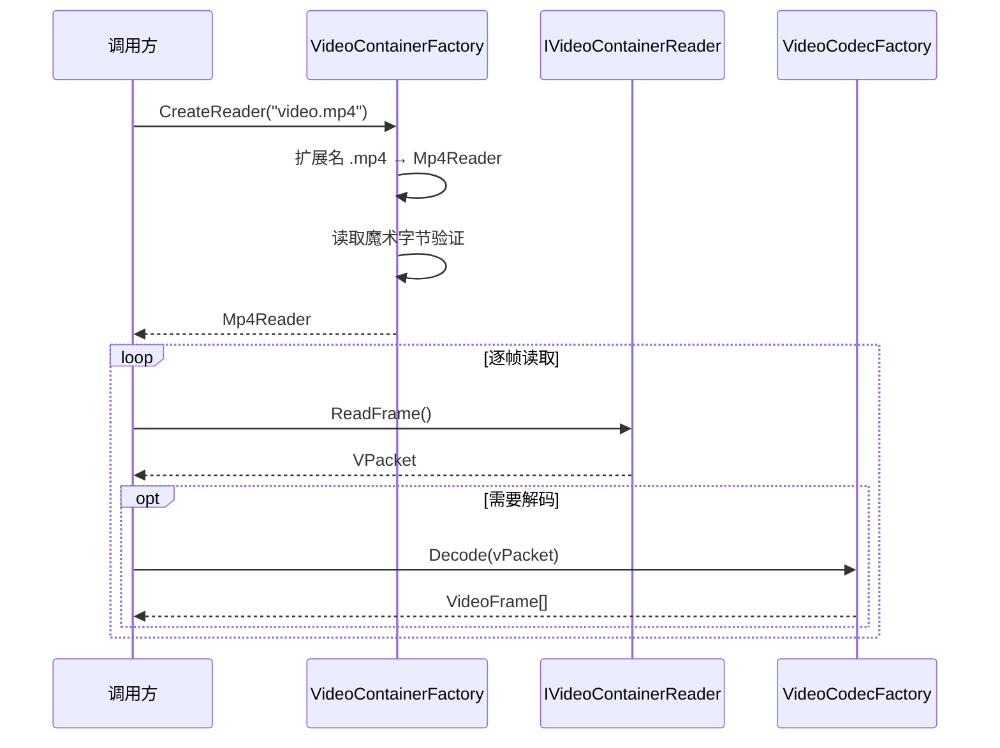
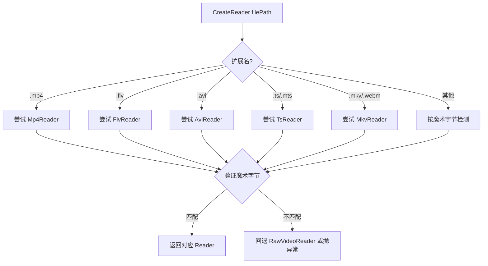

# CONT-视频容器格式

> 版本：v1.0 | 日期：2026-06-29
> 需求对应：[需求文档](需求文档.md) 第 3 章 | 功能清单：[功能模块清单](功能模块清单.md)

---

## 1. 模块职责

| 职责 | 说明 |
|---|---|
| 视频文件读取 | 解析容器结构，提取编码数据流（VPacket 序列）和元数据 |
| 视频文件写入 | 将编码数据流封装为容器格式文件 |
| 格式自动识别 | 根据文件扩展名和魔术字节自动选择读取器/写入器 |
| 元数据管理 | 读取/写入视频宽度、高度、帧率、编码类型、时长等信息 |
| 原始帧读写 | 无容器格式的原始 YUV/RGB 像素数据逐帧读写 |

---

## 2. 核心组件

| 组件 | 说明 | 目录 |
|---|---|---|
| `IVideoContainerReader` | 容器读取器接口：`ReadFrame()` / `SeekFrame()` | `Containers/` |
| `IVideoContainerWriter` | 容器写入器接口：`WriteMetadata()` / `WriteFrame()` / `Flush()` | `Containers/` |
| `VideoContainerFactory` | 容器工厂：`CreateReader(filePath)` / `CreateWriter(filePath)`，按扩展名+魔术字节路由 | 项目根目录 |
| `Mp4Reader` / `Mp4Writer` | 纯托管 MP4 读写器，解析 ISO BMFF 盒结构 | `FMp4/` |
| `FlvReader` / `FlvWriter` | 纯托管 FLV 读写器，解析 FLV Header + Tag | `Flv/` |
| `AviReader` / `AviWriter` | 纯托管 AVI 读写器，RIFF 容器扩展 | `Avi/` |
| `MkvReader` / `MkvWriter` | 纯托管 MKV/WebM 读写器，EBML 基础解析 | `Mkv/` |
| `TsReader` / `TsWriter` | 纯托管 MPEG-2 TS 读写器，PAT/PMT/PES 解析 | `Ts/` |
| `RawVideoReader` / `RawVideoWriter` | 原始视频帧读写器 | `Raw/` |

> 每种容器格式自包含于独立的顶级目录（`Flv/`/`FMp4/`/`Avi/`/`Mkv/`/`Ts/`/`Raw/`），Reader/Writer 与基础设施代码同目录，未来可独立演进。

---

## 3. 关键流程

### 3.1 文件读取流程



### 3.2 格式自动识别



---

## 4. 接口 / 数据结构

### 4.1 IVideoContainerReader

```csharp
/// <summary>视频容器读取器接口</summary>
public interface IVideoContainerReader : IDisposable
{
    /// <summary>视频编码类型</summary>
    VideoTypes VideoCodecType { get; }

    /// <summary>视频宽度</summary>
    Int32 VideoWidth { get; }

    /// <summary>视频高度</summary>
    Int32 VideoHeight { get; }

    /// <summary>帧率</summary>
    Double FrameRate { get; }

    /// <summary>总帧数（-1 表示未知）</summary>
    Int64 TotalFrames { get; }

    /// <summary>时长（毫秒，-1 表示未知）</summary>
    Int64 Duration { get; }

    /// <summary>读取下一帧编码数据</summary>
    /// <returns>编码数据包，流末尾返回 null</returns>
    VPacket ReadFrame();

    /// <summary>跳转到指定帧</summary>
    /// <param name="frameIndex">帧索引</param>
    /// <returns>是否成功</returns>
    Boolean SeekFrame(Int64 frameIndex);
}
```

### 4.2 IVideoContainerWriter

```csharp
/// <summary>视频容器写入器接口</summary>
public interface IVideoContainerWriter : IDisposable
{
    /// <summary>写入元数据头</summary>
    /// <param name="width">视频宽度</param>
    /// <param name="height">视频高度</param>
    /// <param name="codecType">编码类型</param>
    /// <param name="frameRate">帧率</param>
    void WriteMetadata(Int32 width, Int32 height, VideoTypes codecType, Double frameRate);

    /// <summary>写入一帧编码数据</summary>
    /// <param name="packet">编码数据包</param>
    void WriteFrame(VPacket packet);

    /// <summary>刷新缓冲区并完成文件写入</summary>
    void Flush();
}
```

---

## 5. 设计决策

| 决策 | 理由 |
|---|---|
| 容器与编解码分离 | 读取器不自动解码，让调用方决定何时解码；与 NewLife.Audio 的容器设计一致 |
| 纯托管骨架 + FFmpeg 回退 | 常见容器格式（MP4/FLV）的解析逻辑相对简单可纯托管实现；复杂情况回退 FFmpeg |
| 原始帧读写器作为独立格式 | 无容器的 YUV/RGB 原始帧数据在 IoT 场景常见（摄像头直接输出 YUV），需要支持 |
| `ReadFrame()` 返回 `VPacket` | 容器层不关心编码细节，返回统一数据包结构，与编解码引擎通过 VPacket 衔接 |
| 工厂优先扩展名再魔术字节 | 扩展名命中最快；魔术字节兜底覆盖扩展名错误的情况 |
| 容器读取器实现 `IDisposable` | 需要释放文件句柄和 Stream 资源 |

---

（完）
