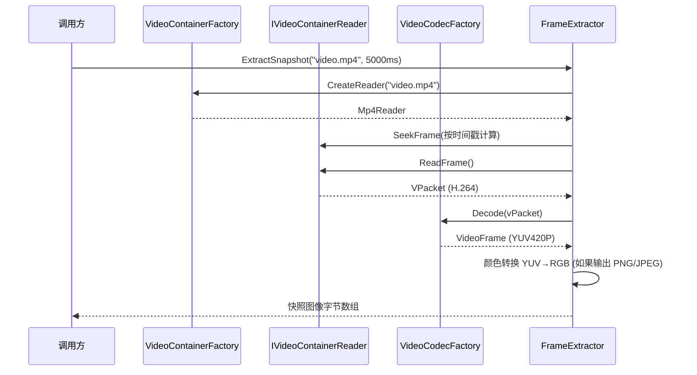

# IMG-图像帧处理

> 版本：v1.0 | 日期：2026-06-29
> 需求对应：[需求文档](需求文档.md) 第 5 章 | 功能清单：[功能模块清单](功能模块清单.md)

---

## 1. 模块职责

| 职责 | 说明 |
|---|---|
| 帧提取 | 从视频流/文件中按时间或帧号提取单帧快照 |
| 缩略图生成 | 提取关键帧并拼接为预览图 |
| 图像序列编码 | 从 `IEnumerable<VideoFrame>` 或图像文件序列生成视频 |
| 运动检测 | 帧差法检测画面中的运动区域 |
| 时间戳叠加 | 在帧上叠加 OSD 文本（时间/通道名等） |

---

## 2. 核心组件

| 组件 | 说明 |
|---|---|
| `FrameExtractor` | 帧快照提取：`ExtractSnapshot(stream, timestamp)` / `ExtractKeyFrames(stream)` |
| `ThumbnailGenerator` | 缩略图生成：提取关键帧 + 按网格拼接 |
| `FrameSequenceEncoder` | 帧序列生成视频 |
| `MotionDetector` | 运动检测：帧差法 + 自适应阈值 + 连通域分析 |
| `TimestampOverlay` | 时间戳叠加：在帧上绘制 OSD 文本 |

---

## 3. 关键流程

### 3.1 帧快照提取



### 3.2 运动检测

```mermaid
flowchart TD
    A[当前帧 + 参考帧] --> B[灰度化: YUV→Y 平面 或 RGB→Gray]
    B --> C[帧差: Math.Abs(curr-ref)]
    C --> D[自适应阈值: 差值>阈值 → 1, 否则 → 0]
    D --> E[形态学处理: 膨胀+腐蚀去噪]
    E --> F[连通域分析: 找运动块]
    F --> G{连通域面积 > 最小面积?}
    G -->|是| H[输出 MotionRegion 列表]
    G -->|否| I[无运动]
```

---

## 4. 设计决策

| 决策 | 理由 |
|---|---|
| 帧提取通过容器+编解码流水线 | 复用 CODEC/CONT 模块而非重复实现 |
| 运动检测仅用 Y 平面 | Y 分量已包含亮度信息，跳过 UV 可减少 50% 计算量 |
| 自适应阈值而非固定阈值 | 不同光照条件下固定阈值不稳定；基于帧差均值和方差的动态阈值更鲁棒 |
| OSD 叠加为独立处理器 | 可插入 PROC 管线作为最后一个处理步骤 |

---

（完）
