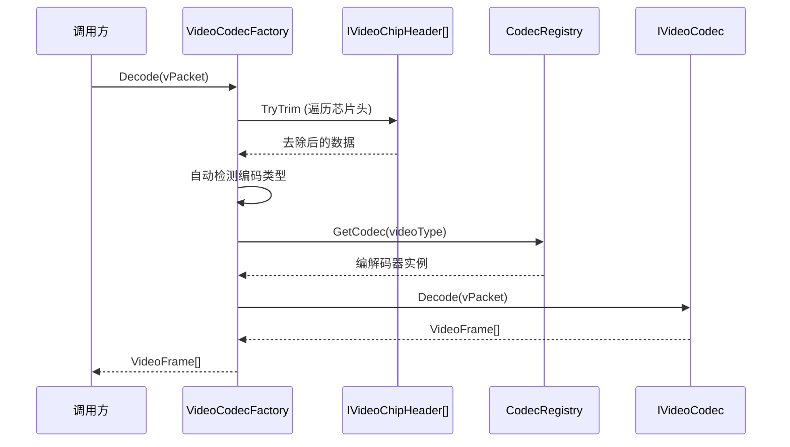
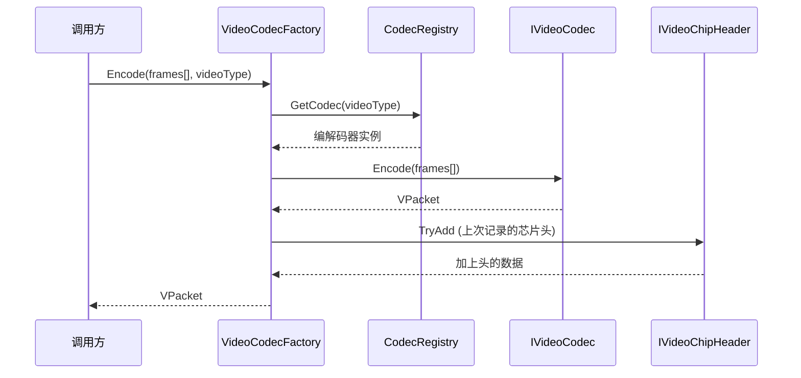
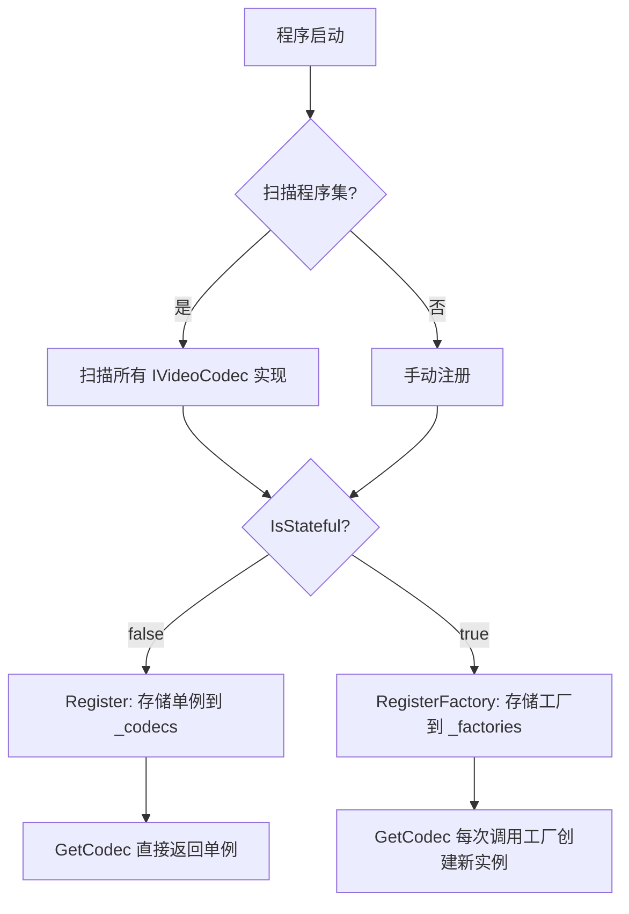

# M1-视频编解码引擎

> 版本：v1.0 | 日期：2026-06-29
> 需求对应：[需求文档](需求文档.md) 第 2 章 | 功能清单：[功能模块清单](功能模块清单.md)

---

## 1. 模块职责

| 职责 | 说明 |
|---|---|
| 编解码路由 | 根据 VideoTypes 查找对应编解码器，无状态单例或有状态工厂创建 |
| 解码 (Decode) | `VPacket`（编码数据）→ `VideoFrame[]`（原始帧） |
| 编码 (Encode) | `VideoFrame[]`（原始帧）→ `VPacket`（编码数据） |
| 芯片视频头适配 | 解码前去头（`TryTrim`），编码后加头（`TryAdd`），自动记忆头类型 |
| 生命周期管理 | 有状态编解码器（H.264/H.265）的创建与释放 |
| 格式自动检测 | 根据数据流起始字节自动识别编码类型 |

---

## 2. 核心组件

| 组件 | 说明 |
|---|---|
| `VideoTypes : Byte` | 视频编码类型枚举（H264/H265/MJPEG/AV1/VP8/VP9/YUV420P/NV12/RGB24等） |
| `IVideoCodec` | 编解码器统一接口：`Decode(VPacket)` / `Encode(VideoFrame[])` |
| `ICodecInfo` | 编解码器元数据：Name/Version/SupportedTypes/IsStateful |
| `VideoFrame` | 视频帧数据：Width/Height/PixelFormat/Data(Span)/Timestamp |
| `VPacket` | 视频数据包：Data/CodecType/PTS/DTS/IsKeyFrame |
| `VideoCodecFactory` | 编解码工厂主入口：`Decode(VPacket)` / `Encode(VideoFrame[], VideoTypes)` / 芯片头处理 |
| `CodecRegistry` | 编解码器注册表：`Register(IVideoCodec)` / `RegisterFactory(Func<>())` / `GetCodec(VideoTypes)` |
| `IVideoChipHeader` | 芯片视频头接口：`TryTrim(Packet)` / `TryAdd(Packet)` / `Priority` |
| `MjpegCodec` | 纯托管 MJPEG 编解码器（无状态，IsStateful=false） |
| `ColorSpaceConverter` | 纯托管 YUV↔RGB 颜色空间转换 |
| `FFmpegInvoker` | FFmpeg 进程封装：调用管理/参数构建/管道通信/进度解析 |
| `FFmpegH264Decoder` | FFmpeg H.264 解码器（有状态，IsStateful=true） |
| `FFmpegH264Encoder` | FFmpeg H.264 编码器（有状态） |
| `FFmpegH265Decoder` | FFmpeg H.265 解码器（有状态） |
| `FFmpegH265Encoder` | FFmpeg H.265 编码器（有状态） |
| `HisiliconVideoHeader` | 海思芯片视频头 |
| `DahuaVideoHeader` | 大华芯片视频头 |
| `UniviewVideoHeader` | 宇视芯片视频头 |

---

## 3. 关键流程

### 3.1 解码流程



### 3.2 编码流程



### 3.3 编解码器注册流程



---

## 4. 接口 / 数据结构

### 4.1 IVideoCodec

```csharp
/// <summary>视频编解码器接口</summary>
public interface IVideoCodec
{
    /// <summary>解码编码数据为原始帧</summary>
    /// <param name="packet">编码数据包</param>
    /// <returns>解码后的视频帧数组（一包可能解出多帧）</returns>
    VideoFrame[] Decode(VPacket packet);

    /// <summary>编码原始帧为编码数据</summary>
    /// <param name="frames">原始视频帧数组</param>
    /// <returns>编码后的数据包</returns>
    VPacket Encode(VideoFrame[] frames);
}
```

### 4.2 ICodecInfo

```csharp
/// <summary>编解码器元数据接口</summary>
public interface ICodecInfo
{
    /// <summary>编解码器名称</summary>
    String Name { get; }

    /// <summary>版本</summary>
    String Version { get; }

    /// <summary>支持的视频编码类型集合</summary>
    VideoTypes[] SupportedTypes { get; }

    /// <summary>是否为有状态编解码器</summary>
    Boolean IsStateful { get; }
}
```

### 4.3 VideoFrame

```csharp
/// <summary>视频帧</summary>
public class VideoFrame
{
    /// <summary>宽度（像素）</summary>
    public Int32 Width { get; set; }

    /// <summary>高度（像素）</summary>
    public Int32 Height { get; set; }

    /// <summary>像素格式</summary>
    public VideoTypes PixelFormat { get; set; }

    /// <summary>帧数据</summary>
    public Byte[] Data { get; set; }

    /// <summary>时间戳（毫秒）</summary>
    public Int64 Timestamp { get; set; }

    /// <summary>是否为关键帧</summary>
    public Boolean IsKeyFrame { get; set; }
}
```

### 4.4 VPacket

```csharp
/// <summary>视频数据包</summary>
public class VPacket
{
    /// <summary>数据</summary>
    public Byte[] Data { get; set; }

    /// <summary>编码类型</summary>
    public VideoTypes CodecType { get; set; }

    /// <summary>显示时间戳</summary>
    public Int64 PTS { get; set; }

    /// <summary>解码时间戳</summary>
    public Int64 DTS { get; set; }

    /// <summary>是否为关键帧</summary>
    public Boolean IsKeyFrame { get; set; }
}
```

### 4.5 IVideoChipHeader

```csharp
/// <summary>芯片视频头接口</summary>
public interface IVideoChipHeader
{
    /// <summary>优先级，数字越小越先尝试</summary>
    Int32 Priority { get; }

    /// <summary>尝试去除芯片头</summary>
    /// <param name="packet">数据包</param>
    /// <returns>是否成功去除</returns>
    Boolean TryTrim(VPacket packet);

    /// <summary>添加芯片头</summary>
    /// <param name="packet">数据包</param>
    void TryAdd(VPacket packet);
}
```

---

## 5. 设计决策

| 决策 | 理由 |
|---|---|
| `Decode` 返回 `VideoFrame[]` 而非单个帧 | H.264/H.265 一包可能含多帧（如 IDR 后的多个 P 帧），解码器可能批量输出 |
| 芯片头独立接口 | 与 NewLife.Audio 的 `IAudioChipHeader` 设计一致；不同芯片格式不同，工厂按优先级链式尝试 |
| 无状态编解码器用单例注册 | MJPEG 等纯托管编解码器无内部状态，所有流共享一个实例减少 GC |
| 有状态编解码器用工厂注册 | H.264/H.265 需要维护解码器上下文（参考帧列表等），每个流独立实例 |
| 芯片头自动记忆 | 解码时记录成功去除的头类型，编码时自动还原；上层无需感知 |
| `VPacket` 非 `Packet` 子类 | 保持与 NewLife.Audio 的类型独立；未来可通过适配器互转 |
| FFmpeg 通过管道通信而非临时文件 | 避免磁盘 I/O；适合实时流场景；`FFMpegCore` 已验证此模式 |
| YUV↔RGB 独立为静态工具类 | 不是编解码器（不涉及压缩），而是颜色空间转换；被编解码器和处理器共同使用 |

---

（完）
