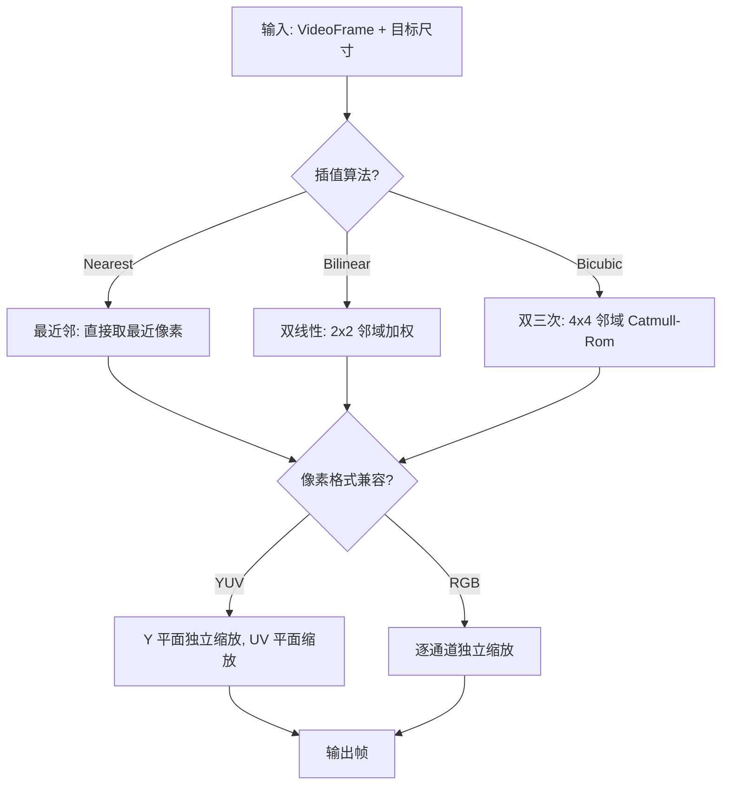

# M3-视频处理与转换

> 版本：v1.0 | 日期：2026-06-29
> 需求对应：[需求文档](需求文档.md) 第 4 章 | 功能清单：[功能模块清单](功能模块清单.md)

---

## 1. 模块职责

| 职责 | 说明 |
|---|---|
| 帧变换 | 缩放、裁剪、旋转、翻转等几何变换 |
| 色彩处理 | 亮度、对比度、饱和度、色彩空间转换 |
| 效果叠加 | 文字/图像水印叠加 |
| 帧率调整 | 抽帧降帧率、帧复制/插值升帧率 |
| 处理管线 | 链式组合多个处理器，自动管理像素格式转换 |

---

## 2. 核心组件

| 组件 | 说明 |
|---|---|
| `IVideoProcessor` | 处理器统一接口：`ProcessFrame(VideoFrame) → VideoFrame` |
| `VideoPipeline` | 处理管线：链式组合多个 IVideoProcessor，自身也是 IVideoProcessor |
| `FrameResizer` | 帧缩放：最近邻/双线性/双三次插值 |
| `FrameCropper` | 帧裁剪 |
| `FrameRotator` | 帧旋转与翻转 |
| `ColorSpaceProcessor` | 色彩空间转换处理器（封装 M1-5 的 ColorSpaceConverter） |
| `FrameRateConverter` | 帧率转换器 |
| `ColorAdjuster` | 色彩调整：亮度/对比度/饱和度 |
| `WatermarkOverlay` | 水印叠加 |

---

## 3. 关键流程

### 3.1 处理管线


处理管线使用**拉模型**（Pull Model）：
- 管线串联多个处理器，每个处理器从前一个处理器获取帧
- 调用 `Pipeline.ProcessFrame(input)` → 自动依次经过所有处理器 → 返回最终帧
- 处理器内部可自动插入格式转换：如 `FrameResizer` 要求 RGB 输入但收到 YUV420P，自动插入 `ColorSpaceProcessor`

### 3.2 帧缩放流程



---

## 4. 接口 / 数据结构

### 4.1 IVideoProcessor

```csharp
/// <summary>视频处理器接口</summary>
public interface IVideoProcessor
{
    /// <summary>支持的输入像素格式</summary>
    VideoTypes[] SupportedInputFormats { get; }

    /// <summary>输出像素格式</summary>
    VideoTypes OutputFormat { get; }

    /// <summary>处理视频帧</summary>
    /// <param name="frame">输入帧</param>
    /// <returns>处理后的帧</returns>
    VideoFrame ProcessFrame(VideoFrame frame);
}
```

### 4.2 VideoPipeline

```csharp
/// <summary>视频处理管线</summary>
public class VideoPipeline : IVideoProcessor
{
    private readonly List<IVideoProcessor> _processors = [];

    /// <summary>添加处理器</summary>
    public VideoPipeline Append(IVideoProcessor processor)
    {
        _processors.Add(processor);
        return this;
    }

    /// <summary>移除处理器</summary>
    public VideoPipeline Remove(IVideoProcessor processor)
    {
        _processors.Remove(processor);
        return this;
    }

    /// <summary>处理视频帧，依次经过所有处理器</summary>
    public VideoFrame ProcessFrame(VideoFrame frame)
    {
        var current = frame;
        foreach (var processor in _processors)
        {
            current = processor.ProcessFrame(current);
        }
        return current;
    }
}
```

---

## 5. 设计决策

| 决策 | 理由 |
|---|---|
| 拉模型而非推模型 | 与 NewLife.Audio 的 `IAudioProcessor.Read()` 拉模型一致；调用方控制处理时机 |
| 不引入 `Source` 属性 | 视频处理通常是单帧变换而非连续流；`Source` 模式在流式音频中更有意义 |
| 每个处理器返回新帧 | 避免原地修改带来的副作用；后续可加入帧池化优化 |
| 缩放保实现多种插值 | 最近邻适合像素艺术/测试；双线性适合一般场景；双三次适合高质量需求 |
| 管线自动插入格式转换 | 减少用户手动转换的负担；类似 ML 框架的自动设备转换 |
| 处理器不关心帧来源 | 与编解码器和容器完全解耦，可独立测试 |

---

（完）
