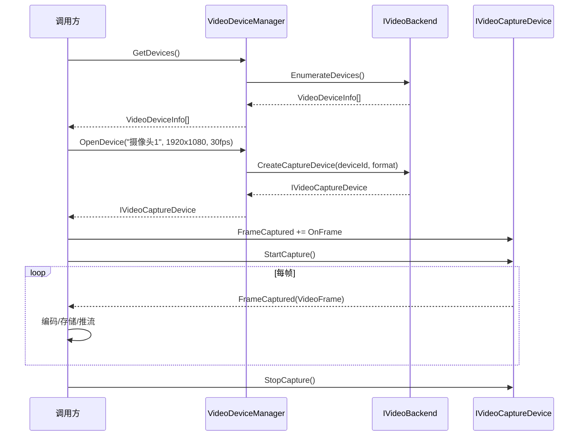

# M5-视频设备I/O

> 版本：v1.0 | 日期：2026-06-29
> 需求对应：[需求文档](需求文档.md) 第 6 章 | 功能清单：[功能模块清单](功能模块清单.md)

---

## 1. 模块职责

| 职责 | 说明 |
|---|---|
| 设备发现 | 枚举系统视频捕获设备（摄像头） |
| 视频采集 | 从摄像头/屏幕获取视频帧 |
| 后端适配 | 跨平台抽象，Windows DirectShow / Linux V4L2 |
| 生命周期管理 | 设备打开→启动采集→停止→释放 |

---

## 2. 核心组件

| 组件 | 说明 |
|---|---|
| `IVideoCaptureDevice` | 捕获设备接口：`Name` / `SupportedFormats` / `StartCapture()` / `StopCapture()` / `FrameCaptured` 事件 |
| `VideoDeviceInfo` | 设备信息：名称、ID、支持的分辨率和帧率列表 |
| `VideoDeviceManager` | 设备管理：枚举设备、获取设备详细信息和格式 |
| `IVideoBackend` | 后端适配器接口：枚举设备、创建采集器 |
| `VideoBackendFactory` | 后端工厂：根据平台创建对应后端 |
| `DirectShowBackend` | Windows DirectShow 后端 |
| `V4L2Backend` | Linux V4L2 后端 |

---

## 3. 关键流程

### 3.1 摄像头采集流程

---

## 4. 设计决策

| 决策 | 理由 |
|---|---|
| 后端适配器模式 | 与 NewLife.Audio 的 `IAudioBackend` 模式一致；平台差异封装在具体后端 |
| 事件驱动帧采集 | 摄像头帧到达是被动的，事件模型最自然；高频场景可加帧缓冲避免丢帧 |
| 先 Win 后 Linux | Windows IoT 设备占多数；Linux V4L2 通过条件编译逐步支持 |
| 格式协商 | 设备支持的分辨率和帧率有限，需提供匹配/回退逻辑 |

---

（完）
