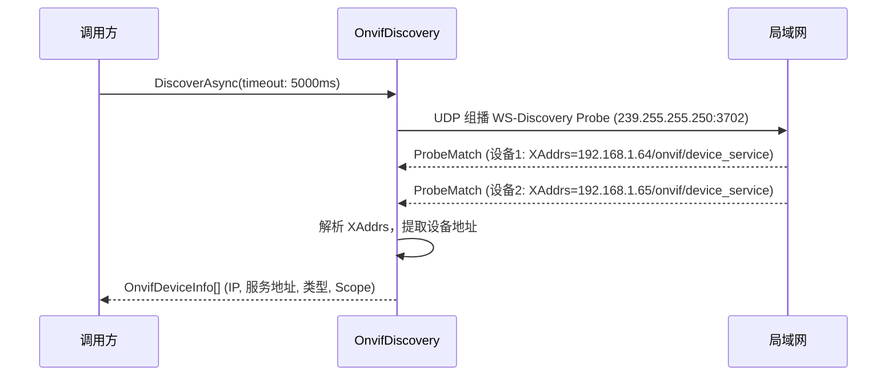
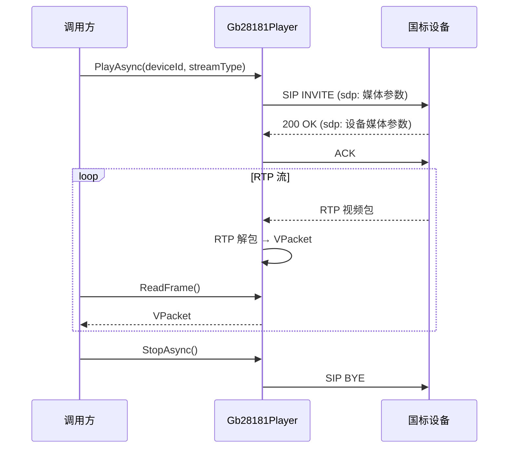
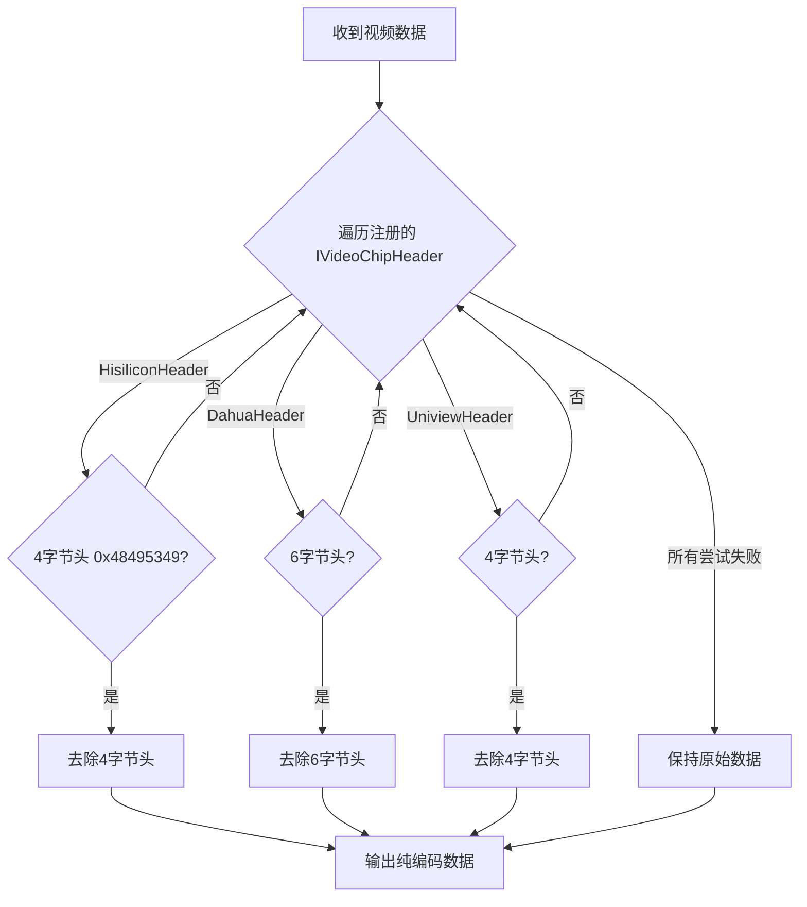

# M7-IoT视频适配

> 版本：v1.0 | 日期：2026-06-29
> 需求对应：[需求文档](需求文档.md) 第 8 章 | 功能清单：[功能模块清单](功能模块清单.md)

---

## 1. 模块职责

| 职责 | 说明 |
|---|---|
| ONVIF 设备发现 | 通过 WS-Discovery 协议在局域网内发现 ONVIF 摄像头 |
| ONVIF 媒体服务 | 获取摄像头媒体配置（Profile/Stream URI/Snapshot URI） |
| ONVIF PTZ 控制 | 云台控制（旋转、变焦、预置位） |
| GB/T 28181 接入 | 国标设备注册、心跳、实时点播 |
| 录像计划 | 定时录像、事件触发录像、录像文件管理 |
| IoT 芯片视频头 | 海思/大华/宇视的视频帧专有头适配 |

---

## 2. 核心组件

| 组件 | 说明 |
|---|---|
| `OnvifDiscovery` | ONVIF WS-Discovery：UDP 组播发现 + XAddrs 解析 |
| `OnvifMediaClient` | ONVIF 媒体服务：GetProfiles/GetStreamUri/GetSnapshotUri |
| `OnvifPtzClient` | ONVIF PTZ 服务：AbsoluteMove/RelativeMove/ContinuousMove/GotoPreset |
| `Gb28181Registrar` | 国标注册：SIP REGISTER + 心跳 Keep-Alive |
| `Gb28181Player` | 国标实时点播：SIP INVITE 拉流 |
| `RecordingScheduler` | 录像计划管理：定时/事件触发/分段管理 |
| `HisiliconVideoHeader` | 海思视频帧头 |
| `DahuaVideoHeader` | 大华视频帧头 |
| `UniviewVideoHeader` | 宇视视频帧头 |

---

## 3. 关键流程

### 3.1 ONVIF 设备发现

### 3.2 GB/T 28181 实时点播

### 3.3 芯片视频头适配

---

## 4. 设计决策

| 决策 | 理由 |
|---|---|
| ONVIF 基于 WS-Discovery + SOAP | 行业标准协议，无需反向工程 |
| GB/T 28181 基于 SIP | 国标强制要求，SIP 信令 + RTP 媒体 |
| 芯片头与 M1 共享接口 | `IVideoChipHeader` 统一定义，M7 提供具体实现，M1 工厂全局注册 |
| PTZ 操作为独立组件 | 云台控制与视频流无关，独立使用更灵活 |
| 录像计划不绑定特定存储 | 预留存储接口，支持本地文件/NAS/云存储 |

---

（完）
