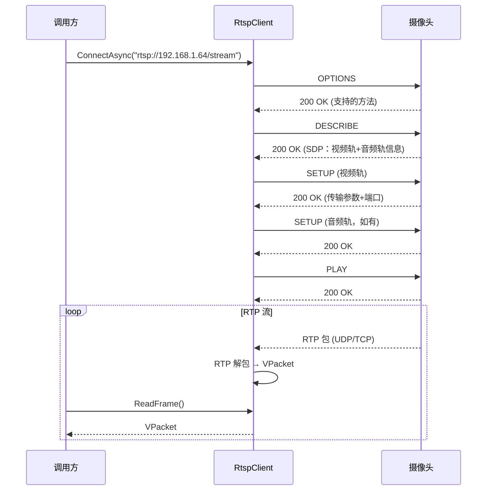
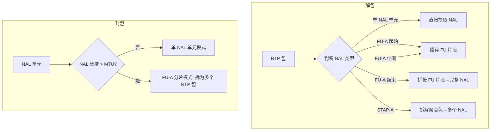

# STRM-视频流媒体

> 版本：v1.0 | 日期：2026-06-29
> 需求对应：[需求文档](需求文档.md) 第 7 章 | 功能清单：[功能模块清单](功能模块清单.md)

---

## 1. 模块职责

| 职责 | 说明 |
|---|---|
| RTSP 拉流 | 通过 RTSP 协议从摄像头/服务器拉取视频流 |
| RTP 封包解包 | H.264/H.265 的 RTP 载荷封装与解析 |
| RTMP 推流 | 将视频流推送到 RTMP 服务器 |
| HLS 输出 | 生成 m3u8 播放列表和 TS 分段 |
| WebSocket 传输 | 基于 WebSocket 的双向视频帧传输 |
| 抖动缓冲 | 平滑网络抖动，保证播放流畅 |

---

## 2. 核心组件

| 组件 | 说明 |
|---|---|
| `RtspClient` | RTSP 客户端：信令交互 + RTP 接收 + 解包输出 VPacket |
| `RtpPacket` | RTP 数据包结构体（RFC 3550） |
| `RtpH264Packetizer` | H.264 RTP 封包/解包（RFC 6184，单NAL/FU-A/STAP-A） |
| `RtpH265Packetizer` | H.265 RTP 封包/解包（RFC 7798） |
| `RtmpClient` | RTMP 推流客户端：握手 + 信令 + FLV 流推送 |
| `HlsSegmenter` | HLS 分段器：TS 分段生成 + m3u8 播放列表 |
| `WebSocketVideoPipe` | WebSocket 视频帧双向通道 |
| `JitterBuffer` | 抖动缓冲：可配置延迟，重排序，丢包补偿 |

---

## 3. 关键流程

### 3.1 RTSP 拉流

### 3.2 RTP H.264 封包/解包 (RFC 6184)

---

## 4. 设计决策

| 决策 | 理由 |
|---|---|
| RTSP 基于 NewLife.Net | 复用成熟的 TCP/UDP Socket 实现；与 NewLife.Audio 一致 |
| RTP 独立于传输层 | RTP 可在 UDP/TCP/HTTP 隧道上传输，独立设计复用性高 |
| RTMP 仅实现推流客户端 | IoT 场景以推送视频到服务器为主 |
| JitterBuffer 可配置 | 不同场景对延迟/流畅的平衡不同（监控 200ms vs 直播 2s） |
| 实施优先级：RTP > RTSP > RTMP > HLS > WebSocket | 按 IoT 场景需求优先级排序 |

---

（完）
