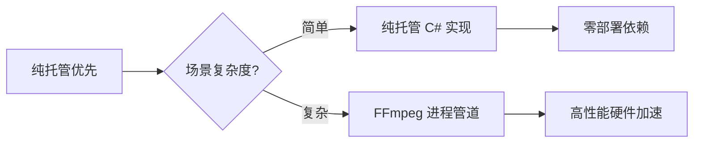
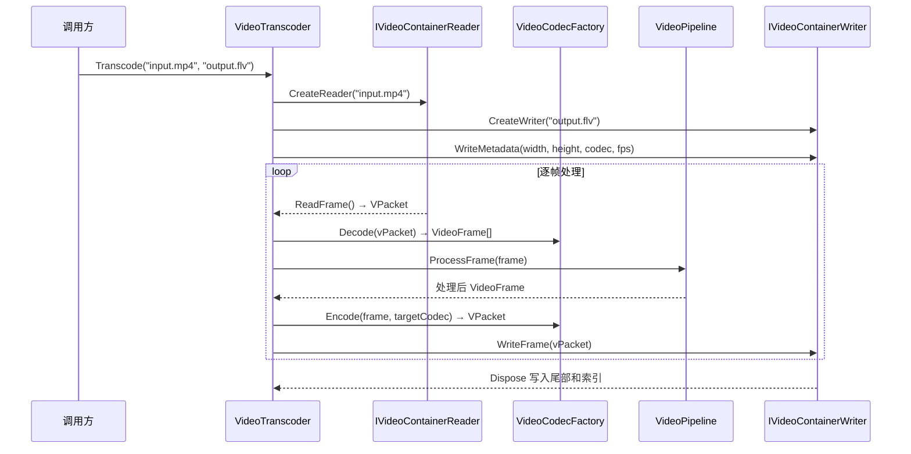

# NewLife.Video 架构设计

> 版本：v2.0 | 日期：2026-07-20

本文档描述 NewLife.Video 的整体架构设计，涵盖分层结构、模块交互、关键流程和设计决策。

> **编码说明**：自 v2.0 起采用字母前缀编码方案。编码映射：`M1→CODEC` `M2→CONT` `M3→PROC` `M4→IMG` `M5→DEV` `M6→STRM` `M7→IOT` `M8→TRANS` `M9→PLAY`。各模块的详细设计参见专项文档。

---

## 1. 项目概览

### 1.1 项目结构

| 项目 | 目标框架 | 定位 |
|------|----------|------|
| `NewLife.Video` | netstandard2.0/2.1/net461 | 视频处理核心库 |
| `NewLife.Video.Studio` | net8.0 | Avalonia 桌面管理工具 |
| `XUnitTest` | net8.0 | 单元测试与集成测试 |

### 1.2 外部依赖

| 依赖 | 版本 | 用途 |
|------|------|------|
| `NewLife.Core` | NuGet | 核心基础设施（网络/缓存/日志/工具类） |
| `NewLife.Audio` | NuGet | AAC 编解码及 AudioSpecificConfig |

> 无其他外部 NuGet 依赖。简单操作（MJPEG、YUV↔RGB、容器解析、帧处理、图像编码）纯托管实现；复杂编解码（H.264/H.265/VP8/VP9/AV1）委托 FFmpeg 进程。

### 1.3 设计哲学



- **纯托管优先**：MJPEG 编解码、YUV↔RGB 转换、所有容器格式读写、帧处理管线、图像编码（PNG/GIF/WebP）均为纯 C# 实现
- **FFmpeg 通道**：H.264/H.265/VP8/VP9/AV1 编解码通过进程管道委托 FFmpeg，支持硬件编码器参数透传（NVENC/QSV/AMF）
- **接口统一**：所有编解码器实现 `IVideoCodec`，所有容器读写器实现 `IVideoContainerReader`/`IVideoContainerWriter`，所有帧处理器实现 `IVideoProcessor`

---

## 2. 分层架构

### 2.1 逻辑分层

```
┌─────────────────────────────────────────────────────────────┐
│                    应用层 (TRANS/PLAY)                        │
│  VideoTranscoder / FfmpegPlayer / CameraStreamManager        │
├─────────────────────────────────────────────────────────────┤
│                    流媒体层 (STRM)                            │
│  RtspClient / RtmpClient / HlsSegmenter / JitterBuffer       │
├─────────────────────────────────────────────────────────────┤
│              IoT适配层 (IOT)        设备层 (DEV)              │
│  OnvifDiscovery / Gb28181          DirectShow / V4L2         │
├─────────────────────────────────────────────────────────────┤
│                    处理层 (PROC/IMG)                          │
│  VideoPipeline / FrameResizer / MotionDetector               │
│  GifEncoder / PngEncoder / WebPEncoder                       │
├─────────────────────────────────────────────────────────────┤
│                    容器层 (CONT)                              │
│  Mp4Reader/Writer / FlvReader/Writer / AviReader/Writer      │
│  TsReader/Writer / MkvReader/Writer / RawVideoReader/Writer  │
├─────────────────────────────────────────────────────────────┤
│                    编解码层 (CODEC)                           │
│  MjpegCodec / FFmpegH264Codec / ColorSpaceConverter          │
│  VideoCodecFactory / CodecRegistry                           │
├─────────────────────────────────────────────────────────────┤
│                    数据模型层                                 │
│  VideoFrame / VPacket / VideoTypes                           │
└─────────────────────────────────────────────────────────────┘
```

### 2.2 数据流（典型转码管线）



---

## 3. 核心模块架构

### 3.1 CODEC 视频编解码引擎

| 组件 | 类型 | 职责 |
|------|------|------|
| `VideoTypes` | enum | 编码类型枚举（H264/H265/MJPEG/AV1/VP8/VP9/YUV420P/NV12/RGB24等） |
| `IVideoCodec` | interface | 编解码统一接口：`Decode(VPacket)→VideoFrame[]` / `Encode(VideoFrame[])→VPacket` |
| `ICodecInfo` | interface | 编解码器元数据：Name/Version/SupportedTypes/IsStateful |
| `VideoCodecFactory` | class | 编解码工厂入口，管理芯片头适配和编解码器路由 |
| `CodecRegistry` | class | 编解码器注册表，支持单例注册和有状态工厂注册 |
| `MjpegCodec` | class | 纯托管 MJPEG 编解码（无状态） |
| `FFmpegH264Decoder/Encoder` | class | H.264 FFmpeg 管道编解码（有状态） |
| `FFmpegH265Decoder/Encoder` | class | H.265 FFmpeg 管道编解码（有状态） |
| `ColorSpaceConverter` | class | 纯托管 YUV↔RGB 颜色空间转换（SIMD 加速） |
| `IVideoChipHeader` | interface | 芯片视频头接口：TryTrim/TryAdd/Priority |
| `ExpGolombReader` | ref struct | 指数哥伦布编码读取器（零分配） |
| `NALUHeader` | struct | H.264 NAL 单元头解析 |

**关键设计决策**：
- 有状态 vs 无状态：H.264/H.265 编解码器有状态（FFmpeg 进程持有），MJPEG 无状态
- 芯片头适配在 `VideoCodecFactory` 层自动处理，对上层透明
- 硬件编码器参数通过 `FFmpegArgs` 构建器透传，无需独立实现 NVENC/QSV 模块

### 3.2 CONT 视频容器格式

**基础设施层**：

| 组件 | 位置 | 职责 |
|------|------|------|
| FLV 枚举/结构体 | `Flv/` | TagType/CodecId/AudioFormat/FrameType 等枚举；FlvHeader/FlvTags 等结构 |
| AMF3 元数据系统 | `Flv/` | Amf3 + IAmf3Metadata + 12 种元数据类型 |
| ISO BMFF Box 模型 | `FMp4/` | Mp4Box→FullBox 层级；49+ 标准 Box 类型（ftyp/moov/moof/trak/mdat/stsd等） |
| 零分配写入器 | `Flv/` `FMp4/` | FlvBufferWriter / FMp4BufferWriter（ref partial struct） |

**读写器层**：

| 格式 | 读取器 | 写入器 | 目录 |
|------|--------|--------|------|
| MP4 | Mp4Reader | Mp4Writer | `FMp4/` |
| FLV | FlvReader | FlvWriter | `Flv/` |
| AVI | AviReader | AviWriter | `Avi/` |
| TS | TsReader | TsWriter | `Ts/` |
| MKV/WebM | MkvReader | MkvWriter | `Mkv/` |
| 原始帧 | RawVideoReader | RawVideoWriter | `Raw/` |
| fMP4/CMAF | — | Fmp4SegmentWriter | `FMp4/` |

**接口**：

| 接口 | 关键方法 |
|------|----------|
| `IVideoContainerReader` | `ReadFrame()` / `SeekFrame()` / VideoCodecType/TotalFrames/Duration/VideoWidth/VideoHeight |
| `IVideoContainerWriter` | `WriteMetadata()` / `WriteFrame()` / `Flush()` |
| `VideoContainerFactory` | `CreateReader(filePath)` / `CreateWriter(filePath)` — 按扩展名+魔术字节路由 |

### 3.3 PROC 视频处理与转换

| 组件 | 职责 |
|------|------|
| `IVideoProcessor` | 处理器统一接口：`ProcessFrame(VideoFrame) → VideoFrame`（拉模型） |
| `VideoPipeline` | 链式处理管线，自动管理格式转换 |
| `FrameResizer` | 帧缩放：最近邻/双线性/双三次插值 |
| `FrameCropper` | 帧裁剪 |
| `FrameRotator` | 帧旋转与翻转：90°/180°/270° + 水平/垂直镜像 |
| `ColorSpaceProcessor` | 色彩空间转换（封装 CODEC-5） |
| `FrameRateConverter` | 帧率转换：抽帧/帧复制 |
| `ColorAdjuster` | 色彩调整：亮度/对比度/饱和度 |
| `WatermarkOverlay` | 文字水印叠加 |
| `FFmpegFilterProcessor` | FFmpeg 滤镜链集成（去噪/锐化/去隔行等） |

### 3.4 IMG 图像帧处理

| 组件 | 职责 | 实现方式 |
|------|------|----------|
| `FrameExtractor` | 帧快照提取（按时间/帧号/关键帧） | 纯托管 |
| `ThumbnailGenerator` | 关键帧缩略图拼接 | 纯托管 |
| `FrameSequenceEncoder` | 帧序列→视频编码 | 纯托管 |
| `MotionDetector` | 运动检测：帧差法+自适应阈值+连通域分析 | 纯托管 |
| `TimestampOverlay` | OSD 时间戳叠加 | 纯托管 |
| `PngEncoder` | VideoFrame→PNG 编码 | 纯托管（DeflateStream+CRC32+Paeth） |
| `GifEncoder` | VideoFrame→GIF/动画GIF 编码 | 纯托管（自研 LZW+自适应调色板） |
| `WebPEncoder` | VideoFrame→WebP 无损编码 | 纯托管（VP8L 格式） |
| `FrameBatchEncoder` | 批量帧图像编码管线 | 纯托管 |

**快照输出格式覆盖**：JPEG（纯托管）/PNG（纯托管）/WebP（纯托管）/BMP（纯托管）/TIFF（纯托管）/GIF（纯托管）/AVIF（FFmpeg 管道）

### 3.5 DEV 视频设备 I/O

| 组件 | 职责 | 平台 |
|------|------|------|
| `IVideoCaptureDevice` | 设备捕获接口：StartCapture/StopCapture/FrameCaptured | 跨平台 |
| `VideoDeviceManager` | 设备枚举与管理 | 跨平台 |
| `IVideoBackend` | 后端适配器接口 | 跨平台 |
| `VideoBackendFactory` | 后端工厂：按平台选择 | 跨平台 |
| `DirectShowBackend` | DirectShow 摄像头采集 | Windows |
| `V4L2Backend` | V4L2 摄像头采集 | Linux |
| `AVFoundationBackend` | AVFoundation 骨架 | macOS |
| `ScreenCapture` | 屏幕捕获 | Windows/跨平台 |

### 3.6 STRM 视频流媒体

| 组件 | 职责 | 协议/标准 |
|------|------|-----------|
| `RtspClient` | RTSP 拉流客户端 | RFC 2326 |
| `RtpH264Packetizer` | H.264 RTP 封包/解包 | RFC 6184（单NAL/FU-A/STAP-A） |
| `RtpH265Packetizer` | H.265 RTP 封包/解包 | RFC 7798 |
| `RtmpClient` | RTMP 推流客户端 | RTMP 规范 |
| `HlsSegmenter` | HLS 分段器 | RFC 8216 |
| `WebSocketVideoPipe` | WebSocket 视频帧双向通道 | 自定义长度前缀帧协议 |
| `JitterBuffer` | 抖动缓冲 | 按 PTS 排序+延迟输出 |

### 3.7 IOT IoT 视频适配

| 组件 | 职责 | 协议 |
|------|------|------|
| `OnvifDiscovery` | ONVIF 设备发现 | WS-Discovery (UDP 组播) |
| `OnvifMediaClient` | 媒体服务（Profiles/StreamUri/SnapshotUri） | ONVIF Media |
| `OnvifPtzClient` | PTZ 云台控制 | ONVIF PTZ |
| `OnvifRecordingClient` | Profile G 边缘存储操作 | ONVIF Recording |
| `Gb28181Registrar` | 国标设备注册与心跳 | GB/T 28181 (SIP) |
| `Gb28181Player` | 国标实时点播 | GB/T 28181 (SIP INVITE) |
| `RecordingScheduler` | 录像计划管理 | 定时+事件触发 |
| `HisiliconVideoHeader` | 海思芯片视频头 | — |
| `DahuaVideoHeader` | 大华芯片视频头 | — |
| `UniviewVideoHeader` | 宇视芯片视频头 | — |

### 3.8 TRANS 高级转码与编排

| 组件 | 职责 |
|------|------|
| `FFmpegSetup` | FFmpeg 运行时自动检测/下载/缓存 |
| `VideoTranscoder` | 一键转码 API：格式转换/分辨率缩放/编码器切换/码率控制 |

### 3.9 PLAY 视频流式播放

| 组件 | 职责 |
|------|------|
| `FfmpegPlayer` | FFmpeg 进程管道播放器，支持 RTSP/RTMP/HLS/本地文件，`FrameDecoded` 事件输出原始帧 |
| `Fmp4WebSocketStreamer` | fMP4 over WebSocket 实时推送 + RTSP→WebSocket 桥接 |
| `CameraStreamManager` | 多路摄像头连接管理：连接池/自动重连/健康监测 |
| `VideoFrameRenderer` | 纯托管帧渲染器：VideoFrame→BGRA32 内存缓冲区 |

---

## 4. 关键设计决策

### 4.1 纯托管 + FFmpeg 混合策略

| 操作类型 | 实现方式 | 理由 |
|----------|----------|------|
| 容器解析/封装 | 纯托管 | 格式固定、复杂度可控、零依赖部署 |
| MJPEG 编解码 | 纯托管 | 基线 JPEG 算法，无需外部库 |
| YUV↔RGB 转换 | 纯托管 SIMD | 高频热点，纯托管可控性能 |
| 帧处理/图像编码 | 纯托管 | 算法明确，无硬件依赖 |
| H.264/H.265 编解码 | FFmpeg 进程管道 | 算法极其复杂，FFmpeg 是行业标准 |
| VP8/VP9/AV1 编解码 | FFmpeg 进程管道 | 同上 |
| 流协议 | 纯托管 + NewLife.Net | 有状态协议，纯托管更可控 |

### 4.2 接口统一设计

所有核心能力通过接口抽象，支持多实现切换：

- `IVideoCodec` — 编解码器接口（纯托管 MJPEG 和 FFmpeg 管道实现可互换）
- `IVideoContainerReader` / `IVideoContainerWriter` — 容器读写器接口（7 种格式统一接口）
- `IVideoProcessor` — 帧处理器接口（纯托管和 FFmpeg 滤镜可互换）
- `IVideoCaptureDevice` / `IVideoBackend` — 设备采集接口（多平台后端可互换）

### 4.3 有状态 vs 无状态编解码器

- **无状态**（`IsStateful=false`）：单例注册，如 MJPEG 编解码器，每次 `Decode`/`Encode` 独立
- **有状态**（`IsStateful=true`）：工厂注册，如 H.264/H.265 编解码器持有 FFmpeg 进程，每次调用工厂创建新实例

### 4.4 零分配热路径优化

- `ExpGolombReader` — ref struct 避免堆分配
- `FlvBufferWriter` / `FMp4BufferWriter` — ref partial struct，基于 `Span<byte>` 零分配大端写入
- `NALUHeader` — readonly struct

### 4.5 芯片视频头透明适配

`VideoCodecFactory` 在编解码前后自动处理芯片头：

```
解码：原始数据 → TryTrim(去头) → 标准数据 → Decode
编码：原始帧 → Encode → 标准数据 → TryAdd(加头) → 芯片数据
```

### 4.6 运行时多语言与带前缀日志

- 词表以英文原文为键，编译期由 NewLife.Core 源生成器内嵌，缺失译文运行时回退英文
- 日志统一走 `VideoLog`，内部调用 NewLife.Core 的 `WritePrefixed`：先按日志语言翻译消息，再拼接 `[Video]`/`[FFmpeg]` 前缀，避免带动态前缀的整串查表失败
- 低版本目标框架（netstandard2.0/2.1、net461）由本地 `ModuleInitializerAttribute` 提供编译期支持，模块初始化器在运行时注册词表

---

## 5. 待补充

| 编号 | 内容 | 优先级 |
|------|------|:------:|
| A1 | 各容器格式内部数据结构详解（FLV Tag/MP4 Box/EBML 等） | 低（已有专项 Doc） |
| A2 | FFmpeg 进程管道通信协议细节 | 低（实现细节） |
| A3 | Studio 桌面工具架构（Avalonia MVVM） | 中 |
| A4 | 性能基准测试数据（编解码吞吐量/容器读写速度） | 高 |

---

（完）
